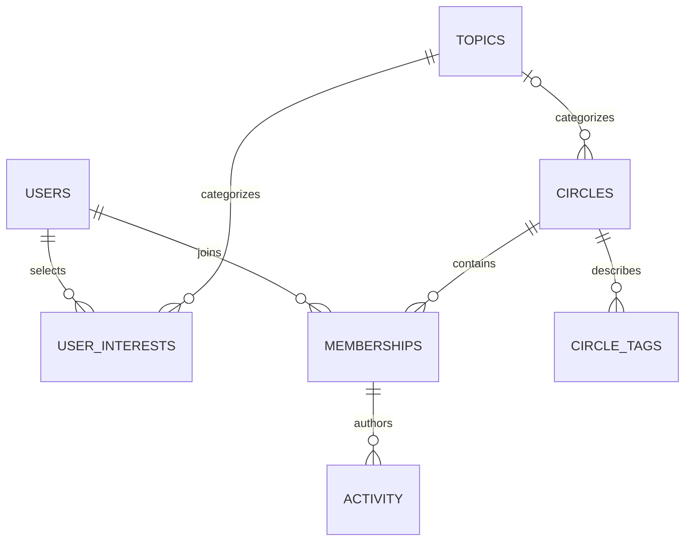

# Database schema

The executable schema is `db/schema.sql`. Source JSON is preserved; import normalizes repeated topic interests and tags into sets.

| Table | Key and relationship | Rationale |
| --- | --- | --- |
| `topics` | Integer PK; unique slug | Canonical slugs shared by users and Circles |
| `users` | Integer PK | Preserve profile data; missing fields remain nullable |
| `user_interests` | PK `(user_id, topic_slug)`; FKs to users and topics | Many-to-many interests without duplicated slugs or JSON queries |
| `circles` | Integer PK; unique slug; nullable topic FK | Missing topic is valid; null capacity means uncapped |
| `circle_tags` | PK `(circle_id, tag)`; FK to Circles | Free-form strings have no taxonomy FK; duplicate tags collapse |
| `memberships` | PK `(user_id, circle_id)`; FKs to users and Circles | A leader is a member with a different role |
| `activity` | Integer PK; composite FK `(author_user_id, circle_id)` to memberships | Enforces that a post author belongs to that Circle |
| `metadata` | Text PK | Stores fixture date independently of machine clock |

## Constraints and loading

Foreign keys are explicitly enabled on every connection. CHECK constraints enforce enums, nonnegative counts, positive finite capacities, and completeness bounds. Zod validates source types and UTC ISO dates before import, and validates database rows at startup. Source values are inserted with bound parameters.

Import runs in one transaction, deleting child rows before parents. Foreign-key/uniqueness errors or discrepancies between stored member counts and memberships cause rollback. Over-capacity rows are permitted so ranking can reject them defensively. Import does not rewrite source JSON.

`member_count` is a cached aggregate checked during import. A production join path would update the count and membership atomically with a concurrent capacity recheck. The composite post-author FK assumes memberships are retained; production may need membership history or soft deletion so leaving does not invalidate historical posts.

## Index decisions

- Primary keys and unique constraints index IDs/slugs, a user's interests and memberships, and a Circle's tags.
- `memberships(circle_id, user_id)` supports reverse membership/leader joins and count validation.
- `activity(circle_id, created_at)` supports per-Circle time-window aggregation.
- Additional visibility/topic/activity indexes are unnecessary for this startup scan of 40 Circles. At scale, push eligibility/candidate retrieval into SQL, inspect query plans, and index actual access patterns.

No leader-profile feature is used in ranking: profile completeness does not establish facilitation quality. The relationship is available for future evidence-backed features.
